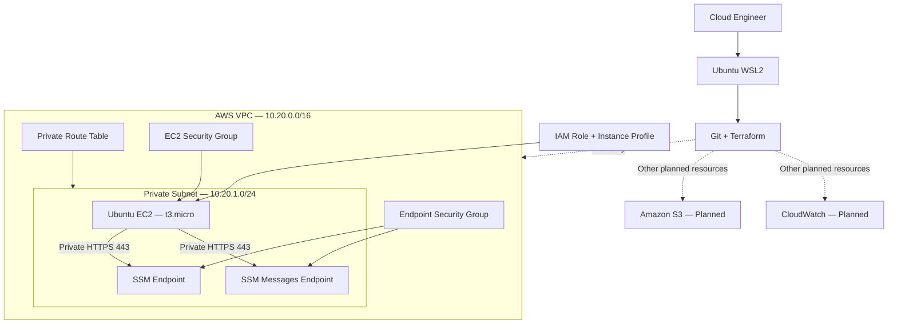

# AWS Cloud Engineering Capstone Architecture

## Project Overview

Design a secure AWS cloud environment using
Terraform, AWS CLI, Bash, Linux, and Git.

## AWS Region

us-east-1

## Architecture Diagram

## Planned AWS Resources

- VPC: 10.20.0.0/16
- Private subnet: 10.20.1.0/24
- Private route table and subnet association
- Ubuntu 24.04 EC2 instance (t3.micro)
- No EC2 public IP
- EC2 security group with outbound HTTPS
- Dedicated SSM endpoint security group
- SSM interface VPC endpoint
- SSM Messages interface VPC endpoint
- IAM role and instance profile
- Amazon S3 with encryption, versioning,
  and public access blocking
- CloudWatch log group and CPU alarm

NGINX installation is planned but not yet
configured or tested.

Terraform plan:
20 to add, 0 to change, 0 to destroy.

Deployment status: PLAN ONLY.

## Security Requirements

- No AWS credentials in GitHub
- No SSH access from 0.0.0.0/0
- Prefer Systems Manager Session Manager
- Encrypt storage where supported
- Use least-privilege IAM permissions

## Deployment Status

PLANNED ONLY.

No AWS infrastructure has been deployed
as part of this capstone.

## Cost Controls

Review estimated costs before deployment.

Do not run terraform apply without approval.

Destroy temporary resources only after review
and explicit authorization.

## Validation Strategy

1. Verify AWS identity.
2. Verify local tools.
3. Validate Terraform configuration.
4. Review Terraform plans.
5. Assess security and cost.
6. Deploy only after explicit approval.
7. Capture actual validation evidence.
