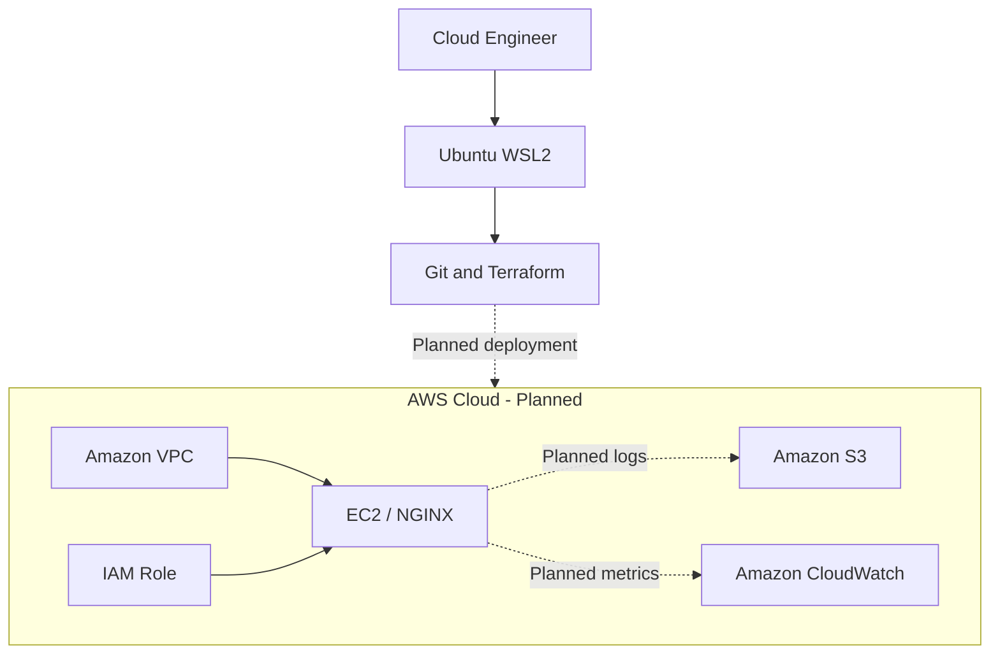

# AWS Cloud Engineering Capstone Architecture

## Project Overview

Design a secure AWS cloud environment using
Terraform, AWS CLI, Bash, Linux, and Git.

## AWS Region

us-east-1

## Architecture Diagram

## Planned AWS Resources

- VPC and subnet
- EC2 instance running NGINX
- IAM role with least-privilege permissions
- S3 bucket for selected artifacts
- CloudWatch monitoring
- Security groups

## Security Requirements

- No AWS credentials in GitHub
- No SSH access from 0.0.0.0/0
- Prefer Systems Manager Session Manager
- Encrypt storage where supported
- Use least-privilege IAM permissions

## Deployment Status

PLANNED ONLY.

No AWS infrastructure has been deployed
as part of this capstone.

## Cost Controls

Review estimated costs before deployment.

Do not run terraform apply without approval.

Destroy temporary resources only after review
and explicit authorization.

## Validation Strategy

1. Verify AWS identity.
2. Verify local tools.
3. Validate Terraform configuration.
4. Review Terraform plans.
5. Assess security and cost.
6. Deploy only after explicit approval.
7. Capture actual validation evidence.
