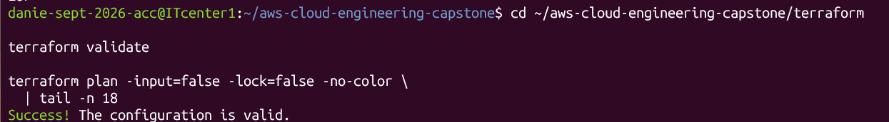

# AWS Capstone Architecture

**Status: Planned only — not deployed**

```mermaid
flowchart TD
    A[Terraform Configuration] --> B[AWS VPC]
    B --> C[Subnet]
    C --> D[EC2 Ubuntu]
    D --> E[IAM Instance Profile]
    E --> F[Systems Manager Permissions]

    A --> G[Amazon S3]
    G --> H[Public Access Block]
    G --> I[Encryption and Versioning]

    A --> J[Amazon CloudWatch]
    J --> K[CPU Alarm]
    J --> L[Log Group]

    D -. Planned Metrics .-> J
    D -. Future Integration .-> G

This diagram represents the Terraform design rather than a deployed AWS environment.

## Step 3 — Create validation evidence

```bash
cat > docs/validation-evidence.md <<'EOF'
# AWS Capstone Validation Evidence

## Environment

- Operating system: Ubuntu WSL2
- Infrastructure tool: Terraform
- AWS region: us-east-1
- Deployment status: NOT DEPLOYED

## Actual Validation Results

### Terraform Formatting

Command:

terraform fmt -check

Result: Passed.

### Terraform Configuration Validation

Command:

terraform validate

Observed result:

Success! The configuration is valid.

### Terraform Execution Plan

Command:

terraform plan -input=false -lock=false -no-color

Observed result:

Plan: 16 to add, 0 to change, 0 to destroy.

### Security Review

Command:

./scripts/review-security.sh

Observed result:

Local configuration inspected.
Deployment readiness: NOT READY.
No AWS resources created or modified.

## Screenshot



The screenshot must show genuine terminal execution.
Do not use a simulated or generated terminal screenshot.

## Important Distinction

VALIDATED:
- Terraform configuration
- Terraform plan
- Local security review

NOT DEPLOYED:
- VPC and subnet
- EC2 instance
- IAM role and instance profile
- S3 bucket
- CloudWatch resources
