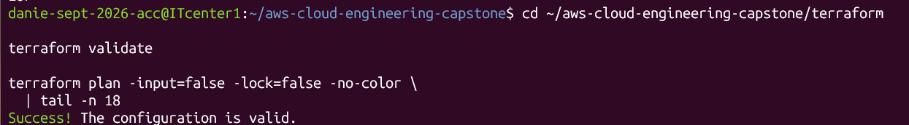

# AWS Cloud Engineering Capstone

## Terraform Validation Evidence

### Project Information

- AWS Region: us-east-1
- Operating System: Ubuntu WSL2
- Infrastructure Tool: Terraform
- Deployment Status: PLAN ONLY — NOT DEPLOYED

### Terraform Formatting

Command:

`terraform fmt -check`

Observed result: Passed.

### Terraform Validation

Command:

`terraform validate`

Observed result:

Success! The configuration is valid.

### Terraform Plan

Command:

`terraform plan -input=false -lock=false -no-color`

Previously observed result:

Plan: 16 to add, 0 to change, 0 to destroy.

### Security Controls

- EC2 public IP disabled
- IMDSv2 required
- EBS encryption enabled
- S3 public access blocking configured
- S3 encryption and versioning configured
- CloudWatch log retention: 7 days
- CloudWatch CPU alarm threshold: 80%
- No explicit SSH ingress rule found

### Security Review

Command:

`./scripts/review-security.sh`

Observed result:

Local configuration inspected.

Deployment readiness: NOT READY.

No AWS resources created or modified.

### Screenshot Evidence

### Deployment Readiness

The Terraform configuration is validated but not deployed.

Remaining work includes:

1. Systems Manager network connectivity
2. Subnet routing design
3. NGINX installation
4. CloudWatch log delivery
5. Alarm notifications
6. AWS cost estimation

### Conclusion

This capstone demonstrates Terraform, AWS infrastructure
planning, Linux, Bash, security review, and GitHub skills.

No terraform apply was executed.
